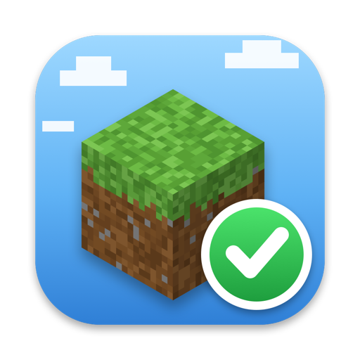

# simpleMCServer

A tiny macOS menu bar app for a vanilla Minecraft server (`java -jar server.jar nogui`).

- **Status at a glance:** block icon in the menu bar with a green check mark while the server runs (orange = busy, red = crashed), plus the number of players online.
- **Start, stop, restart** – the server runs as a child process; quitting the app stops it cleanly. Optionally starts with the app (and the app at login), restarts after crashes.
- **Players:** who's online since when, whisper, op/deop, kick.
- **Whitelist:** add/remove players, switch it on/off. When someone is refused because they're not on the whitelist, you get a notification with an *Add to Whitelist* button (also in the menu and the console).
- **Console:** live log (⌘F to search, chat-only filter), commands with history (↑/↓), chat to everyone.
- **Nightly updates:** from 04:00 (configurable) it asks Mojang's version manifest for a new release. As soon as nobody is online: download (SHA1 checked) → stop → back up the world → swap `server.jar` → start. If the new version doesn't start, the old jar is put back. You get a notification, and the menu shows it for a week. Manually via *Check for Updates…*.
- **World backups:** `Backups/world_<version>_<date>.zip` containing the world, `server.jar` and `server.properties` – unpack it and the world runs again with exactly that version. Before every update, and on demand (also while running: save-off → save-all flush → zip → save-on). The newest 10 are kept; other files in `Backups/` are never touched.
- A server started elsewhere (e.g. in Terminal) is detected and shown read-only (log and players from `logs/latest.log`).

## Requirements

- macOS 14.4+
- Java (the version the server needs, e.g. 25 for Minecraft 26.x)
- Xcode Command Line Tools: `xcode-select --install`

## Build

```sh
./build.sh           # builds build/simpleMCServer.app
./build.sh install   # also copies it to /Applications and launches it
```

The server folder (default `/Volumes/Files/Minecraft`), Java path, memory etc. are in Settings.
